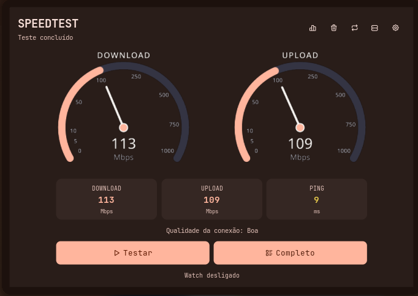

<h1 align="center">SpeedTest para Noctalia</h1>

Faça testes de velocidade sem sair do Noctalia. O painel mostra download, upload e latência em um velocímetro animado, com histórico e informações da conexão.

<p align="center">
  
</p>

<h2 align="center">Recursos</h2>

- Testes simples e completos, com opção de escolher ou listar servidores.
- Velocímetro animado para download e upload, além de download, upload, ping e qualidade da conexão.
- Histórico de resultados, estatísticas e limpeza de registros antigos.
- Modo watch para executar testes automaticamente no intervalo escolhido.
- Widget na barra com ícone configurável, rótulo ocultável e resumo temporário dos resultados.
- Atalho no Controle do Noctalia e opção para instalar ou remover um atalho `.desktop`.

<h2 align="center">Instalação</h2>

Requer Noctalia **v5.4.0 ou mais recente**. Adicione a fonte Git e habilite o plugin:

```sh
noctalia msg plugins source add kinshyyy-speedtest git https://github.com/kinshyyy/noctalia-speedtest.git
noctalia msg plugins enable kinshyyy/speedtest
```

Depois, adicione `kinshyyy/speedtest:bar` à barra. Você também pode abrir o painel pelo atalho no Controle ou com:

```sh
noctalia msg panel-toggle kinshyyy/speedtest:panel
```

Para receber atualizações do repositório:

```sh
noctalia msg plugins update kinshyyy-speedtest
```

<h2 align="center">Configurações</h2>

Em **Configurações → Plugins → SpeedTest**, você pode ajustar:

| Opção | O que faz |
| --- | --- |
| ID do servidor | Usa um servidor específico nos testes. |
| Provedor e IP | Inclui essas informações nos resultados completos. |
| Histórico | Ativa ou desativa o salvamento e permite escolher a pasta. |
| Intervalo do watch | Define a frequência dos testes automáticos, em minutos. |
| Ícone da barra | Escolhe o ícone do widget. |
| Mostrar rótulo | Exibe ou oculta o texto ao lado do ícone. |
| Mostrar resultado temporário | Exibe download e upload na barra ao concluir um teste, mesmo com o rótulo oculto. |
| Duração do resultado | Define por quantos segundos o resumo fica na barra (1–120 s). |
| Notificar resultado | Ativa ou desativa a notificação de download, upload e ping ao fim dos testes. |

<h2 align="center">Motor de teste</h2>

O plugin inclui o script `speedtest.sh` e o localiza pela pasta do próprio plugin, sem depender de um caminho fixo do computador. Ele usa `speedtest-go` ou `speedtest` quando já estão instalados. Se não encontrar nenhum dos dois, tenta instalar `speedtest-go` automaticamente; para isso, precisa de internet e de `curl` e `tar`, ou do Go instalado.

O histórico fica fora da pasta do plugin, por padrão em `Documentos/SpeedTest`, para continuar disponível quando o plugin for atualizado.

<h2 align="center">Desenvolvimento</h2>

O código do plugin `kinshyyy/speedtest` está em [`speedtest/`](speedtest/). Consulte o [README de desenvolvimento e configuração](speedtest/README.md) para mais detalhes.

<h2 align="center">Licença</h2>

MIT. Consulte [`speedtest/plugin.toml`](speedtest/plugin.toml).
